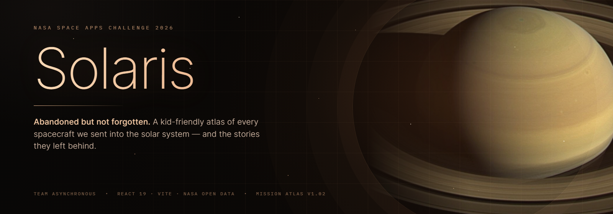
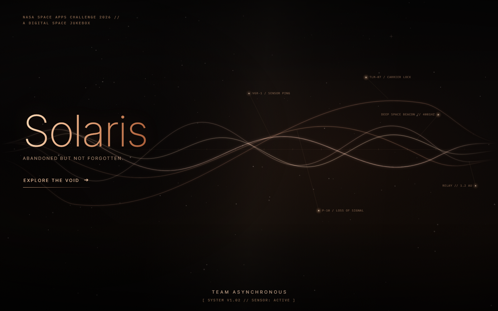
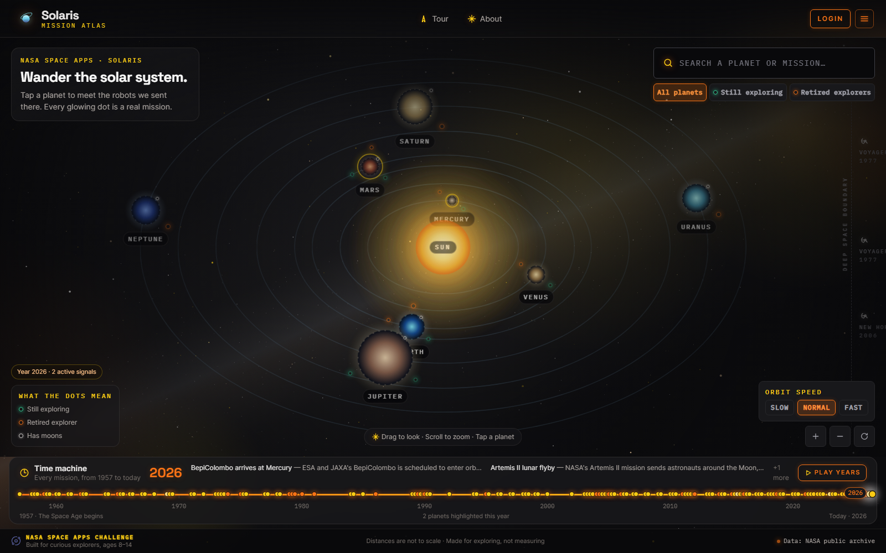
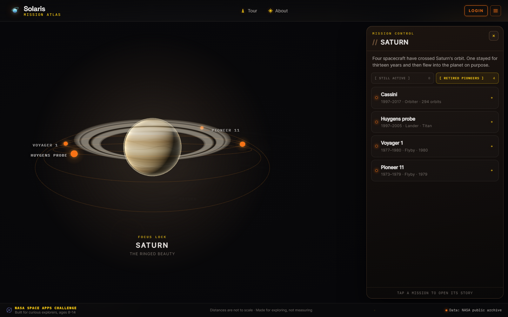
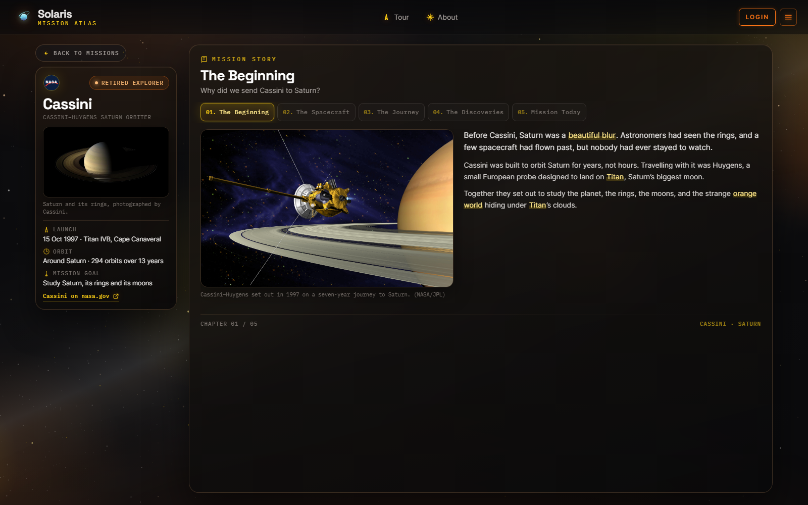
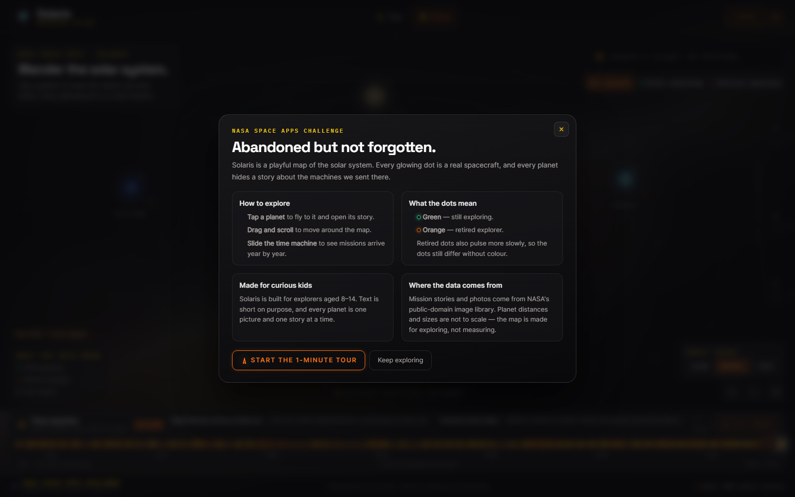
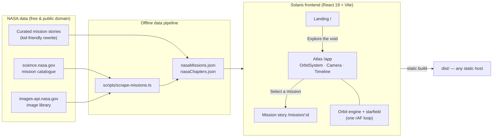

<div align="center">



# Solaris · Mission Atlas

**Abandoned but not forgotten — a kid-friendly atlas of every spacecraft we left in the solar system.**

[](https://www.spaceappschallenge.org/)
[](https://react.dev/)
[](https://vite.dev/)
[](https://www.typescriptlang.org/)
[](https://tailwindcss.com/)
[](LICENSE)

### ▶ [**Live demo — solaris-nasa.web.app**](https://solaris-nasa.web.app)

[**Quick start**](#-quick-start) · [**Screenshots**](#-screenshots) · [**How it works**](#-how-it-works) · [**Docs**](#-documentation) · [**Team**](#-team-asynchronous)

</div>

---

> **Solaris is live at <https://solaris-nasa.web.app>** — deployed on Firebase Hosting (free Spark
> plan). Pushing to `main` rebuilds and redeploys it automatically once the repo secrets are set; see
> [docs/SETUP.md → Deploy to Firebase](docs/SETUP.md#4-deploy-to-firebase-hosting-free-spark-plan).

## What is Solaris?

**Solaris** is an interactive solar-system atlas for curious explorers aged **8–14**. Instead of a
dashboard of charts, it is a playable planetarium: real NASA imagery, slow-moving orbits, glowing
mission dots, a time machine back to 1957, and a one-minute guided tour.

Every glowing dot is a real spacecraft. Tap a planet to fly to it and open **Mission Control** —
then read the mission's story chapter by chapter, from the launch pad to what is still out there
today.

> **One line:** *Solaris turns NASA's catalogue of past and present missions into a storybook you can fly through.*

### The problem

Space agencies have thousands of missions, but that history is buried in tables, PDFs and
Wikipedia. Kids meet a blur of names — Voyager, Cassini, Perseverance — without ever seeing *where*
they went or *what happened to them*.

### Our answer

| | |
|---|---|
| 🌍 **A real map** | Eight planets, the Sun, and every mission placed on the world it explored. |
| 🟢 **Status you can see** | Green (still exploring) and amber (retired explorers) dots — colour **and** shape, so it also works without colour vision. |
| 📖 **Stories, not datasheets** | Five illustrated chapters per mission: *The Beginning → The Spacecraft → The Journey → The Discoveries → Mission Today*. |
| 🕰️ **A time machine** | Drag a timeline from Sputnik (1957) to today and watch the map fill up mission by mission. |
| 🎬 **A guided tour** | A ~60 second cinematic flight from planet to planet, with pause / next / exit controls. |
| 🧒 **Written for kids** | Short sentences, big pictures, 14 px+ body text, and a "still exploring / retired explorer" vocabulary instead of jargon. |

---

## 🚀 Quick start

```bash
# 1. Clone (Git LFS is required — the planet art and fonts live in LFS)
git clone https://github.com/2606tarun-eng/Solaris.git
cd Solaris

# 2. Install the frontend
pnpm install:frontend

# 3. Run it
pnpm dev
```

Open **<http://localhost:5173>** → the landing page. Click **Explore the void** to enter the atlas.

| Route | What you get |
|-------|--------------|
| `/` | Cinematic landing page |
| `/app` | The mission atlas (map, search, filters, timeline) |
| `/mission/:id` | A five-chapter mission story (e.g. `/mission/apollo-17`) |

Need a production build, the optional NASA data backend, or troubleshooting? See
**[docs/SETUP.md](docs/SETUP.md)**.

Ship it: `pnpm deploy:firebase` publishes `dist/` to Firebase Hosting (free Spark plan, one command,
`firebase.json` already configured) — full steps in
**[docs/SETUP.md → Deploy to Firebase](docs/SETUP.md#4-deploy-to-firebase-hosting-free-spark-plan)**.

---

## 📸 Screenshots

<table>
  <tr>
    <td width="50%">
      
      <sub><b>1 · Landing</b> — “Abandoned but not forgotten.”</sub>
    </td>
    <td width="50%">
      
      <sub><b>2 · The atlas</b> — live orbits, mission dots, search and the time machine.</sub>
    </td>
  </tr>
  <tr>
    <td width="50%">
      
      <sub><b>3 · Mission Control</b> — a 3-D planet plus every mission that visited it.</sub>
    </td>
    <td width="50%">
      
      <sub><b>4 · Mission story</b> — five illustrated chapters with real NASA photography.</sub>
    </td>
  </tr>
  <tr>
    <td colspan="2">
      
      <sub><b>5 · Built-in guide</b> — how to explore, what the dots mean, and where the data comes from.</sub>
    </td>
  </tr>
</table>

---

## ✨ Feature tour

| Feature | What it does | Where |
|---|---|---|
| **Pseudo-3D orbit engine** | A single `requestAnimationFrame` loop moves every planet by writing DOM transforms — no React re-render per frame, no WebGL scene graph. Planets scale and fade with orbital depth and pass behind the Sun. | `src/components/OrbitSystem.tsx` |
| **Camera** | Pan, zoom, wheel, pinch and click-to-focus, all as CSS transforms. Focus mode slows the orbits to 10 %. | `src/hooks/useCamera.ts` |
| **Mission Control** | A data-driven drawer per planet: active/retired counts, mission cards, and a shortcut into the story page. | `src/components/MissionControlDrawer.tsx` |
| **Mission stories** | Five chapters per mission with a unique NASA image per chapter, keyboard-navigable tabs, and a friendly "mission not found" fallback. | `src/components/mission-story/` |
| **Time machine** | A scrubbable 1957 → today timeline that reveals missions year by year, with play mode and year highlighting. | `src/components/Timeline.tsx` |
| **Guided tour** | ~60 seconds, planet to planet, pause / next / exit, keyboard aware. | `src/components/GuidedTour.tsx` |
| **Search** | Live results across planets and missions; selecting a result flies the camera to the right world. | `src/components/MissionSearch.tsx` |
| **Starfield** | Adaptive canvas sky with parallax layers, twinkles and shooting stars; pauses when the tab is hidden. | `src/components/StarfieldCanvas.tsx` |
| **Reduced motion** | System-level `prefers-reduced-motion` support: orbits park, twinkles stop, the tour steps instantly. | `src/hooks/useReducedMotion.ts` |
| **Performance tiers** | Star count, DPR and effects adapt to the device. | `src/hooks/usePerformanceTier.ts` |

---

## 🧠 How it works



**Why it feels fast**

- One animation loop for all eight planets; positions are written straight to `element.style` via
  refs, so React never re-renders at 60 fps.
- Transforms and opacity only — no layout thrash, no canvas per planet.
- The NASA catalogue is bundled as JSON, so the atlas is fully functional **offline** and never
  blocks on a network request.
- Image heavy assets are transparent PNG cutouts in `public/assets`, colour-graded for a dark UI.

**Why it is accurate enough**

Planet radii and orbital periods are illustrative, not to scale (the UI says so). What *is* real:
every mission, its agency, launch year, status, target body, and the NASA photography attached to it.

---

## 🛠️ Tech stack

| Layer | Choice | Why |
|---|---|---|
| UI | **React 19** + TypeScript | Component model, strict typing |
| Build | **Vite 8** | Instant HMR, tiny config, static output |
| Styling | **Tailwind CSS v4** + custom CSS layers | Utility speed with a bespoke space design system |
| Animation | **Framer Motion** | Landing-page choreography |
| 3-D | **three.js / @react-three/fiber / drei** | The cinematic planet close-up only |
| Data | Bundled JSON + TypeScript modules | Offline-first, no API keys |
| Optional API | **Fastify + SQLite (Drizzle)** | Caching, search and a voice agent |

---

## 📁 Project structure

```text
.
├── frontend/                 React 19 + Vite app (the atlas)
│   ├── public/assets/        Planet art, mission photos, icons, fonts (Git LFS)
│   ├── src/
│   │   ├── components/       Landing, atlas, mission control, story pages
│   │   ├── data/             Curated missions, planets, timeline, generated NASA JSON
│   │   ├── hooks/            Camera, performance tier, reduced motion
│   │   ├── lib/              Data adapters, routing helpers, flash transitions
│   │   └── context/          Theme and passport providers
│   └── vite.config.ts        Vite + Tailwind + Figma Make plugins
├── backend/                  Optional Fastify + SQLite API, NASA sync, voice agent
├── docs/                     Architecture, setup, data sources, submission guide
├── .github/                  CI workflow, issue & PR templates
├── AGENTS.md                 Engineering guide + active build plan
└── README.md                 You are here
```

Full map and conventions: **[docs/REPO-GUIDE.md](docs/REPO-GUIDE.md)**.

---

## 🌐 Data & credits

- Mission catalogue, imagery and descriptions: **NASA** — public domain (see
  [NASA media guidelines](https://www.nasa.gov/nasa-brand-center/images-and-media/)).
- Sources: `science.nasa.gov`, `images-api.nasa.gov` (NASA Image and Video Library) and NSSDCA.
- Planet cutouts and orbit artwork live in `frontend/public/assets` and are colour-graded for the UI.
- All mission text is rewritten for a 8–14 audience by the team; every claim is checked against
  the linked NASA page on the mission story page.

Details, licences and attribution rules: **[docs/DATA-SOURCES.md](docs/DATA-SOURCES.md)**.

---

## 📚 Documentation

| Document | Read it when you want to… |
|---|---|
| [docs/SETUP.md](docs/SETUP.md) | Install, run, build, deploy, or fix a broken clone |
| [docs/ARCHITECTURE.md](docs/ARCHITECTURE.md) | Understand the orbit engine, camera, routing and data model |
| [docs/DATA-SOURCES.md](docs/DATA-SOURCES.md) | Know exactly where every fact and image comes from |
| [docs/REPO-GUIDE.md](docs/REPO-GUIDE.md) | Find your way around the repository |
| [docs/SUBMISSION.md](docs/SUBMISSION.md) | See the NASA Space Apps submission sheet |
| [AGENTS.md](AGENTS.md) | Read the engineering plan used while building |
| [backend/README.md](backend/README.md) | Run the optional API and voice agent |
| [CONTRIBUTING.md](CONTRIBUTING.md) | Open an issue or a pull request |

---

## 🗺️ Roadmap

- [x] Landing page, atlas, mission control, story pages
- [x] 1957 → today time machine
- [x] Guided tour, search, keyboard & reduced-motion support
- [x] NASA catalogue scrape + offline JSON
- [ ] Live NASA sync badge and "last updated" indicator in the UI
- [ ] Audio narration for every mission story (voice agent is scaffolded)
- [ ] Classroom mode with printable mission cards
- [ ] Spanish and Hindi translations

---

## 👩‍🚀 Team Asynchronous

Built for the **NASA Space Apps Challenge 2026**.

| Role | Name |
|---|---|
| Design, frontend & data | Tarun |
| Mission research & writing | Team Asynchronous |

> Replace the table with your final team roster and links before submitting.

---

## 📄 License

Code is released under the **[MIT License](LICENSE)**.
NASA imagery and mission data remain the property of NASA and are used under their public-domain
media guidelines; see [docs/DATA-SOURCES.md](docs/DATA-SOURCES.md).

---

<div align="center">
  <sub>“Abandoned but not forgotten.” · Made for curious explorers, ages 8–14.</sub>
</div>
