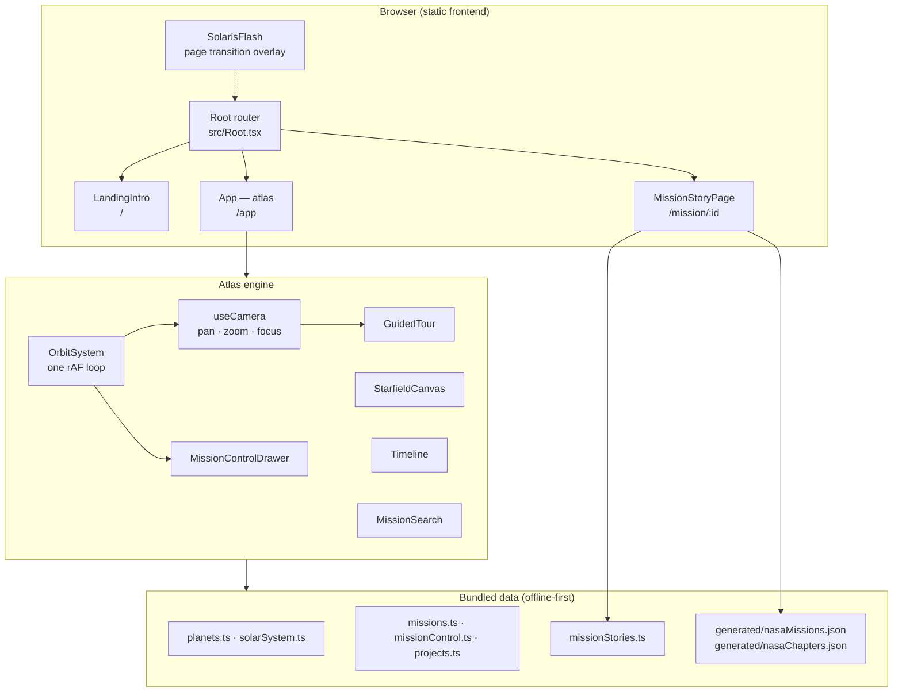

# Architecture

How Solaris is put together, and why. Written to be read by a judge, a new contributor, or a future
maintainer.

---

## 1. The big picture



The shipped product is **100 % static**. No backend is required to browse planets, open Mission
Control, read stories, use the timeline or search. The backend in `backend/` is an optional
companion for cached NASA data and the voice agent.

---

## 2. Routes

| Path | Component | Responsibility |
|---|---|---|
| `/` | `LandingIntro` | Cinematic splash; the warp transition hands off to `/app` |
| `/app` (alias `/system`) | `App` | The atlas: orbits, camera, timeline, search, mission control |
| `/mission/:id` | `MissionStoryPage` | Five-chapter story, loaded from curated data or the NASA catalogue |

Routing is a deliberately tiny history router (`src/Root.tsx`) — `pushState` plus a `popstate`
listener. That keeps the bundle small and avoids a router dependency for three routes.

`src/lib/missionRoute.ts` owns the mapping between mission ids and URLs, so links stay consistent
everywhere.

---

## 3. The orbit engine

`src/components/OrbitSystem.tsx`

- **Solar centre:** `(575, 570)` in stage coordinates.
- **Orbit radii** come from `src/data/solarSystem.ts`.
- **Position:**

  ```text
  x     = cx + rx · cos(θ)
  y     = cy + ry · sin(θ)
  depth = sin(θ)              // -1 = behind the Sun, +1 = in front
  ```

- **Depth drives three things:** scale (≈0.86 → 1.08), opacity
  `(0.78 + (depth + 1) · 0.11)`, and `z-index`. The Sun sits at `z-index: 50`, so planets genuinely
  pass behind it.
- **Periods at 1×:** Mercury 18 s, Venus 24 s, Earth 30 s, Mars 38 s, Jupiter 52 s, Saturn 66 s,
  Uranus 82 s, Neptune 100 s.
- **Speed control:** 0.5× / 1× / 2×; focus mode drops to 10 % so the world feels still while you
  read.
- **Reduced motion** parks every planet at its seeded `startAngle`.

### Why not React state per frame?

A 60 fps React re-render of eight planets (plus 200 mission dots) would burn the main thread. The
engine keeps a mutable planet list and writes **only** `element.style.transform` and `opacity` from a
single `requestAnimationFrame` loop. React renders labels and structure once; the loop animates.
Component positions are published through `positionsRef` so the camera and tour can react without
re-rendering.

---

## 4. Camera

`src/hooks/useCamera.ts`

- Pure CSS-transform camera: `translate3d(…) scale(…)`.
- Inputs: drag to pan, wheel / pinch to zoom, double-click to reset, and `focusPlanet(id)` to fly to a
  world.
- Focus mode zooms to a planet, informs the drawer, and slows the orbits.
- The camera never animates layout properties — only transforms — so it stays GPU-friendly.

`src/lib/flashBus.ts` coordinates the landing → atlas warp: the landing page records the Sun's screen
point, the overlay expands from it, and `App` re-delivers the Sun's new position so the overlay
contracts into the correct spot after the route change. Timing lives in one place (`FLASH_TIMING`) so
the two halves cannot drift.

---

## 5. Data model

| Module | Shape | Notes |
|---|---|---|
| `data/planets.ts` | `Planet` | id, display size, orbital period, seeded angle, label colour, art paths |
| `data/solarSystem.ts` | `orbits[]` | Ellipse geometry for orbit paths and the seeded angles |
| `data/missions.ts` | `missionByPlanet`, `planetStories` | Curated, kid-friendly mission facts and stats |
| `data/projects.ts` | `projectsByPlanet` | Active / retired project dots, with launch and end years |
| `data/missionControl.ts` | `MissionControlEntry[]` | Per-planet panel: hand-authored for Saturn, derived for the rest |
| `data/missionStories.ts` | `MissionProfile` | Five chapters, one unique NASA image per chapter |
| `data/timelineEvents.ts` | `TimelineEvent[]` | 1957 → today; also powers `planetsForYear()` |
| `data/generated/*.json` | NASA catalogue | Produced by `backend/scripts/scrape-missions.ts` |

### Story resolution order

`getMissionStory(id)` (and the async variant) resolves in this order:

1. **Curated profile** in `missionStories.ts` — the best copy and imagery.
2. **Mission Control entry** → `buildFallbackProfile()` generates five honest chapters from the
   mission's real metadata, so *every* mission link resolves.
3. **NASA catalogue** (`nasaStories.ts`, lazy-imported) for missions that only exist in the generated
   JSON.

Unknown ids render a friendly "mission not found" state instead of a crash.

### Timeline

`planetsForYear(year)` filters missions by launch year, so scrubbing the timeline genuinely removes
and reveals dots on the map. `TIMELINE_END` keeps "today" correct as the years pass.

---

## 6. Performance budget

| Concern | Decision |
|---|---|
| React renders | None during animation; refs + styles only |
| Star count | ~220 low tier / ~520 high tier (`usePerformanceTier`) |
| Device pixel ratio | Capped at 1.5–2, so 4K screens don't melt |
| Hidden tab | Starfield pauses; loop is visibility-aware |
| Assets | Static, sized for the stage; no runtime image processing |
| Bundle | Route-level code splitting for the 3-D planet and NASA chapters |
| Long lists | Timeline events are pre-sorted; search filters are O(n) over a small set |

Targets: 60 fps on a normal laptop, 30 fps minimum on low-end hardware, JS heap under ~150 MB.

---

## 7. Visual system

- **Palette:** deep navy/near-black canvas, amber/copper accents (`#e6ae83` family), cyan for
  "still exploring", amber for "retired".
- **Type:** Inter for UI, Space Grotesk for display, IBM Plex Mono for telemetry labels — all
  self-hosted in `public/fonts` (LFS).
- **Craft rules:** body text ≥ 14 px, labels ≥ 12 px, short sentences, one picture per idea, and
  star fields kept low-opacity behind text so contrast survives.
- Status is encoded by **colour and shape**, never colour alone.

---

## 8. Accessibility

- `prefers-reduced-motion` disables orbits, twinkle, parallax and the tour's animation.
- Full keyboard access: Tab reaches planets, dots and controls; Enter selects; Esc exits focus,
  tour and dialogs.
- Search input is a real `<input>` with a live region announcing focus changes.
- Drawers and panels are buttons + ARIA labels, not div-only click targets.
- Planet buttons announce counts in words ("1 project still exploring, 2 retired").
- Colour pairs were chosen for contrast on the dark canvas.

---

## 9. Optional backend

`backend/` — Fastify + SQLite (Drizzle ORM), designed for a free tier.

```text
NASA APIs ──sync/scrape──▶ SQLite (cache) ──Fastify──▶ /api/*
                                                        │
                                        frontend/src/lib/nasa.ts
                                     (uses the API when available,
                                      falls back to bundled JSON)
```

- **Tables:** planets, missions, projects, timeline_events, stories, media, voice_cache, sync_log.
- **Routes:** `/api/health`, `/api/planets`, `/api/missions`, `/api/projects`, `/api/timeline`,
  `/api/stories/:planetId`, `/api/media`, `/api/search?q=`, `POST /api/voice`.
- **Voice agent:** Deepgram (STT) → Gemini (kid-friendly answer using SQLite context) → ElevenLabs
  (TTS). Keys are optional; missing keys degrade to browser speech synthesis.

Full API reference: [`backend/README.md`](../backend/README.md).

---

## 10. Design decisions worth knowing

| Decision | Reason |
|---|---|
| No Three.js for the atlas | A pseudo-3D DOM engine is lighter, accessible, and text stays crisp |
| Bundled JSON instead of live fetches | Kids on school Wi-Fi get the full experience, offline |
| Hand-authored stories + generated fallbacks | Guarantees every mission resolves while keeping quality high where it matters |
| Tiny custom router | Three routes do not justify a router dependency |
| Static-first architecture | Free hosting, instant loads, no API keys, nothing to break during a demo |

---

## 11. Known limitations

- The map is intentionally **not to scale**; distances are compressed so all eight planets are
  readable (the UI says so in the footer).
- Mission coverage depends on the last scrape; the JSON is committed so demos never depend on a
  network call.
- The voice agent needs API keys and is not part of the static demo path.
- The generated NASA catalogue is large; it is lazy-loaded to keep the first paint fast.
- `src/components/CosmicPassport.tsx` and `src/components/KidPlanetLab.tsx` are prototype
  experiences that are not mounted in the current navigation. They are kept in the repository as
  in-progress work and do not affect the shipped atlas.
